<div align="center">


<a href="#-what-is-odyssey"></a>

<br/>


**[What it is](#-what-is-odyssey)** · **[100% RAG](#-built-entirely-on-rag)** · **[Tour](#-take-the-tour)** · **[Stations](#-the-six-stations)** · **[Architecture](#-architecture)** · **[Evaluation](#-evaluation)** · **[Run it](#-run-it-yourself)**

</div>

---

## 🚀 What is ODYSSEY?

**ODYSSEY is an interactive space mission website where every answer is found, not made up.** You play a NASA flight director in training:

- 🛰️ relive **Apollo 13** minute by minute, talk to the crew and make the real crisis decisions,
- 🔴 explore **Mars** through NASA's own photographs,
- 🌌 fly through a **3D map of every known exoplanet** and question it,
- 🪐 **build your own planet** and watch AI scientists argue over whether it could hold life,
- ✦ see all of it joined in one **knowledge graph**,
- 📊 and check how good the retrieval really is on a **measured evaluation dashboard**.

Behind every station is the same idea: **retrieve real evidence first, then let the language model answer only from that evidence, with citations you can click.**

---

## 🧠 Built entirely on RAG

> **Retrieval-Augmented Generation (RAG):** before the AI answers, the system *searches* a knowledge base for the most relevant evidence and hands it to the model. The model must answer from that evidence and cite it, so answers are grounded in real data instead of the model's memory.

ODYSSEY is not one RAG demo. It is **five different kinds of RAG**, one per station, all over real NASA and scientific data:

| | Station | Kind of RAG | What is retrieved | How it is retrieved |
|:-:|---|---|---|---|
| 🛰️ | **Mission Control** | Time-aware **hybrid RAG** | 2,264 conversation chunks of the Apollo 13 radio loop | Vector search + full-text, fused with **Reciprocal Rank Fusion**, **cross-encoder reranking**, relevance cutoff, **query rewriting**, and a **time filter** so the crew never knows the future |
| 🔴 | **Mars** | **Multimodal RAG** | ~1,200 NASA pictures | **CLIP** puts pictures and words in one vector space: search by text, by a picture, or by your own photo |
| 🌌 | **Starship** | **Table RAG** + paper RAG | ~6,000 exoplanet rows + arXiv abstracts | The model writes a **JSON query plan** (never SQL); the server validates it against a whitelist and runs safe, parameterised SQL |
| 🪐 | **Planet Lab** | **Agentic RAG** | Real analog planets + research papers | Feature-vector nearest neighbours + paper search; an **advocate**, a **skeptic** and a **judge** may only cite what was retrieved |
| ✦ | **Knowledge Map** | **GraphRAG** | A graph built from every station, with evidence on each edge | Entity linking → one-hop expansion → collect edge evidence → rerank → answer |
| 📊 | **Evaluation** | RAG **measured** | 25 questions with known answer times | Hit@1/3/5, MRR, "knows when it doesn't know", LLM-judged faithfulness |


---

## 🎬 Take the tour

<div align="center">
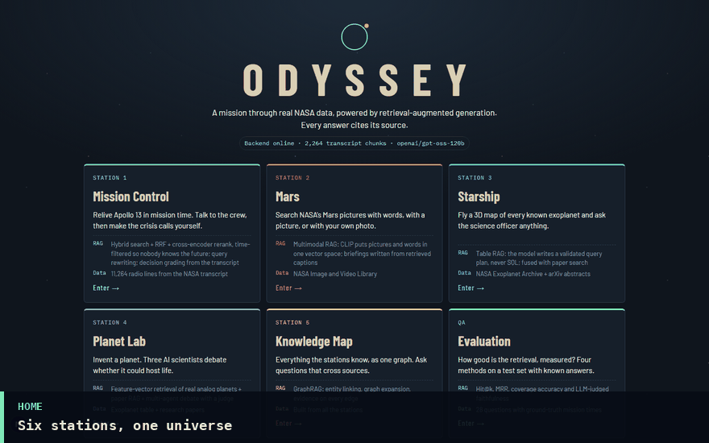
<br/><sub>Every frame is a real run on the full data set. Click a station below to open its screenshots.</sub>
</div>

<table>
<tr>
<td align="center" width="33%"><a href="docs/screenshots/02-mission-control.png">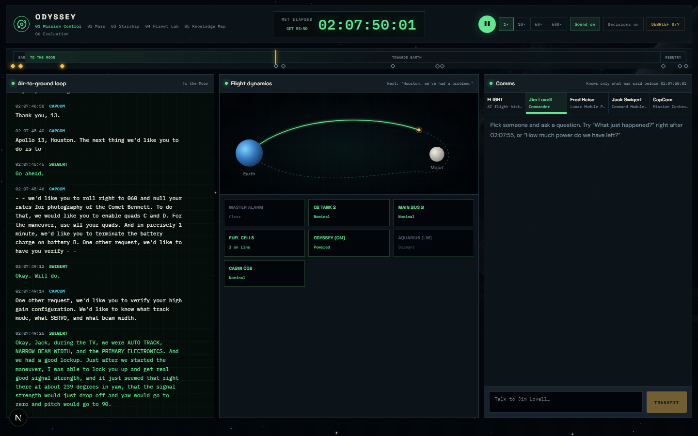</a><br/><b>🛰️ Mission Control</b></td>
<td align="center" width="33%"><a href="docs/screenshots/06-mars.png">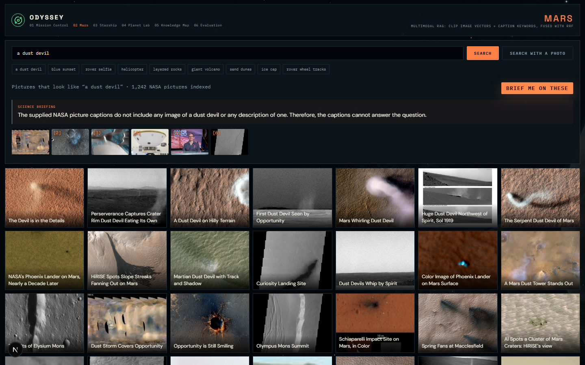</a><br/><b>🔴 Mars</b></td>
<td align="center" width="33%"><a href="docs/screenshots/07-starship.png">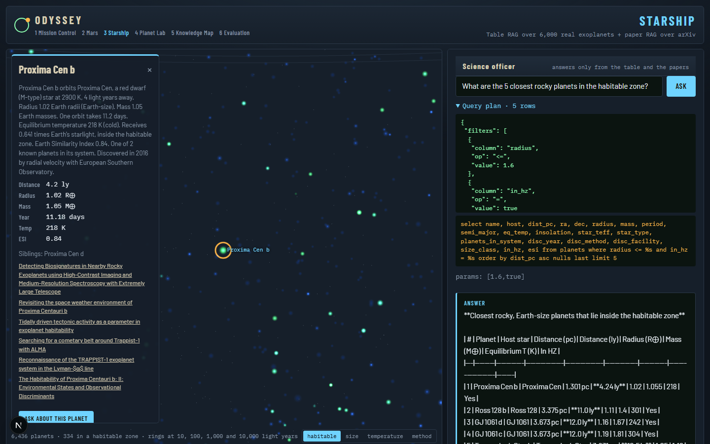</a><br/><b>🌌 Starship</b></td>
</tr>
<tr>
<td align="center"><a href="docs/screenshots/08-planet-lab.png">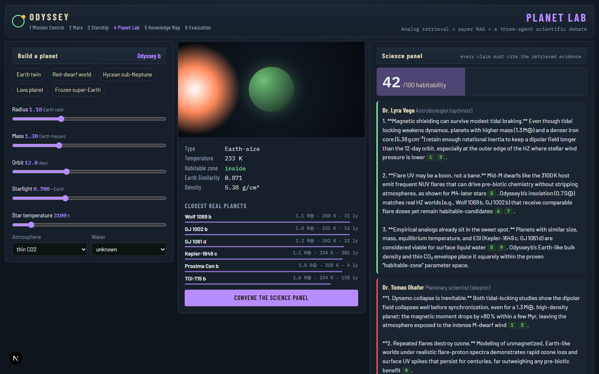</a><br/><b>🪐 Planet Lab</b></td>
<td align="center"><a href="docs/screenshots/09-knowledge-map.png">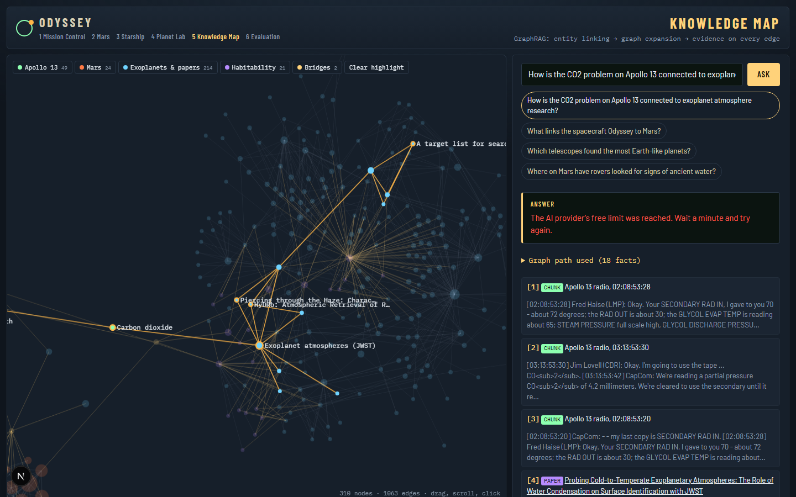</a><br/><b>✦ Knowledge Map</b></td>
<td align="center"><a href="docs/screenshots/10-evaluation.png">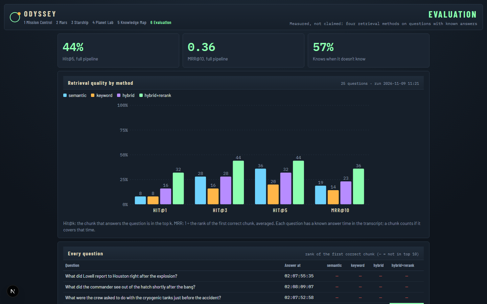</a><br/><b>📊 Evaluation</b></td>
</tr>
</table>

---

## 🪐 The six stations

<details open>
<summary><b>🛰️ Station 1 · Mission Control: relive Apollo 13 and make the calls</b></summary>
<br/>

The real air-to-ground loop plays in **mission time** (1× to 600×). Ask **FLIGHT** (a historian) or talk **in character** to Jim Lovell, Fred Haise, Jack Swigert or CapCom. They only know what has been said *so far*, because retrieval is filtered by the mission clock.

At **7 real crisis moments** the clock stops: power-down, the leaking valve, the lifeboat, the free-return burn, PC+2, the CO₂ "mailbox" and the separation order. You choose; then RAG retrieves the radio lines from that exact moment and FLIGHT explains what Houston really decided. A **debrief** scores you against Houston.

| The radio loop | The clock stops | Houston's real call | Your debrief |
|:-:|:-:|:-:|:-:|
|  | 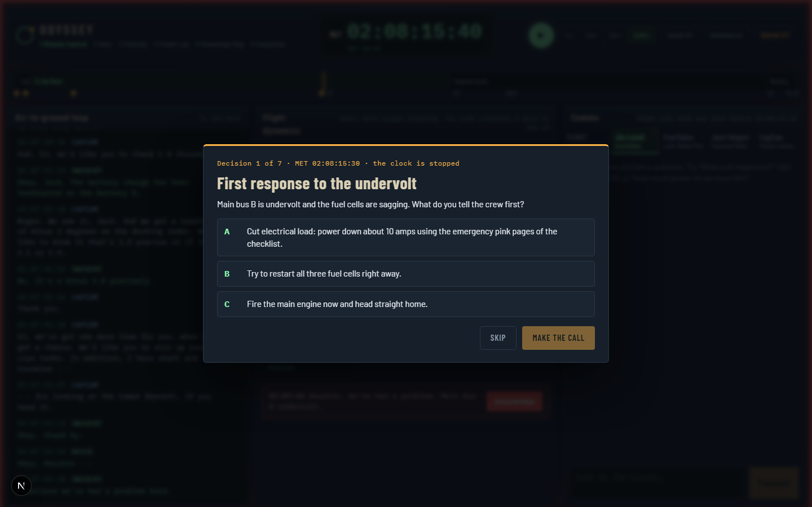 | 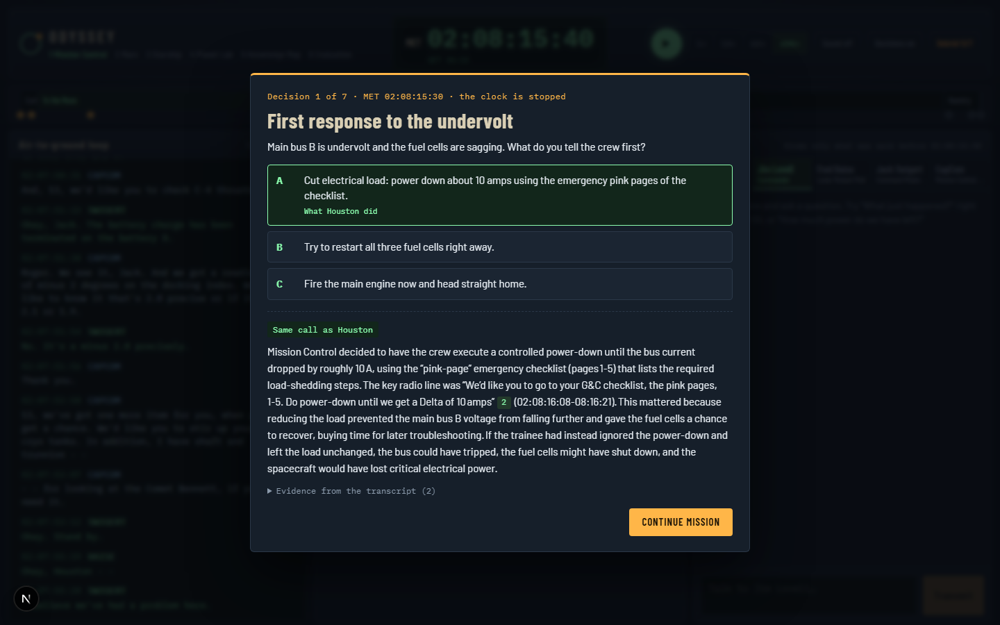 | 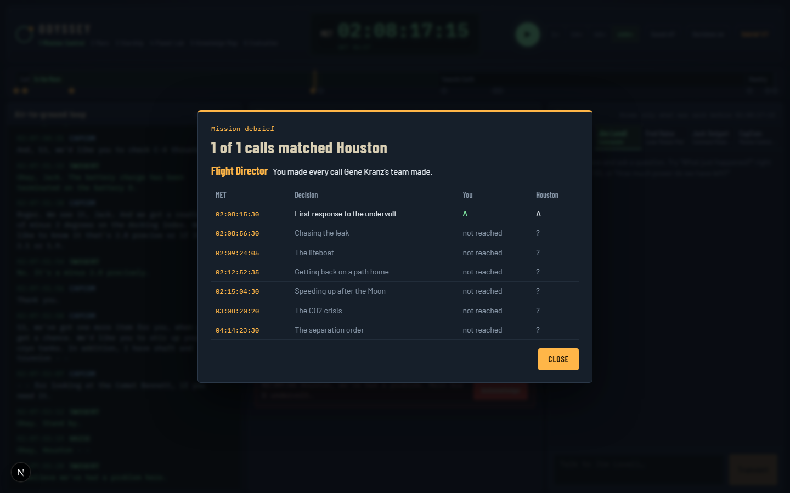 |

</details>

<details>
<summary><b>🔴 Station 2 · Mars: search NASA's pictures with words, a picture, or your photo</b></summary>
<br/>

Type "dust devil", "blue sunset" or "rover selfie", click **More like this**, or upload your own photo. **CLIP** compares meaning across pictures and words, and caption keywords are fused in with RRF. **Brief me** writes a short science briefing from the retrieved captions, citing each picture.


</details>

<details>
<summary><b>🌌 Station 3 · Starship: fly through every known exoplanet</b></summary>
<br/>

A **three.js** galaxy places ~6,000 planets at their real sky position and distance. Ask "the 5 closest rocky planets in the habitable zone" and watch the **query plan** and the **SQL** it became, then a cited answer that mixes exact table rows with research abstracts. The model never writes SQL itself, so a malicious question cannot run anything.


</details>

<details>
<summary><b>🪐 Station 4 · Planet Lab: build a world, then let scientists argue</b></summary>
<br/>

Slide radius, mass, orbit, starlight and star temperature. The lab finds the **closest real planets**, retrieves relevant papers, and convenes a panel: **Dr. Vega** argues for life, **Dr. Okafor** rebuts, and the **Chair** weighs both and gives a **habitability score out of 100**. Every claim must cite the evidence.


</details>

<details>
<summary><b>✦ Station 5 · Knowledge Map: GraphRAG across everything</b></summary>
<br/>

Spacecraft, systems, crew, decisions, planets, stars, telescopes, papers, rovers and Mars places, linked **only by evidence**: co-mention in radio conversations, planet → star → research topic, co-occurrence in picture captions, plus bridges between stations. Ask *"How is the CO₂ problem on Apollo 13 connected to exoplanet atmosphere research?"* and the path through the graph lights up.


</details>

<details>
<summary><b>📊 Evaluation: retrieval quality, measured</b></summary>
<br/>

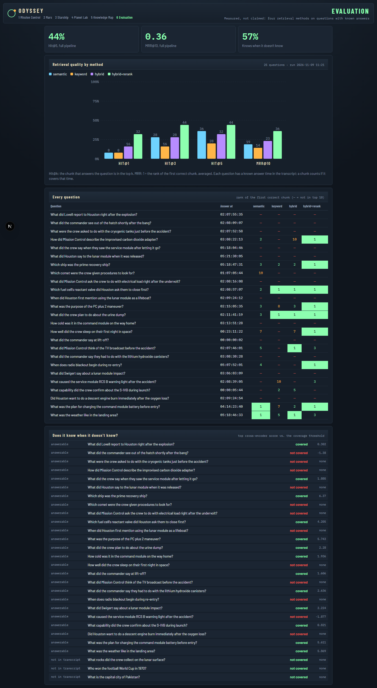
</details>

<details>
<summary><b>📱 It works on phones too</b></summary>
<br/>
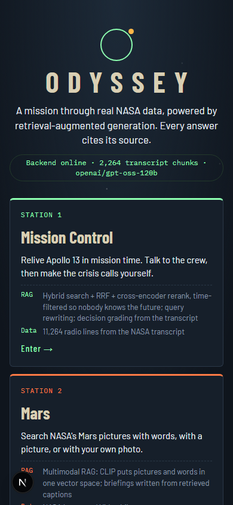
</details>

---

## 🏗️ Architecture

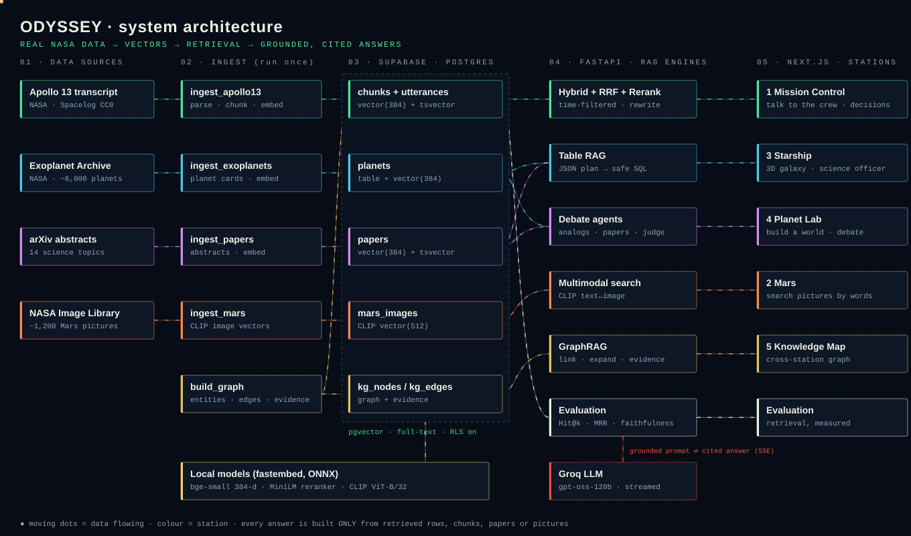

<details>
<summary><b>🔍 Open the interactive diagram</b> (zoom and pan on GitHub)</summary>
<br/>

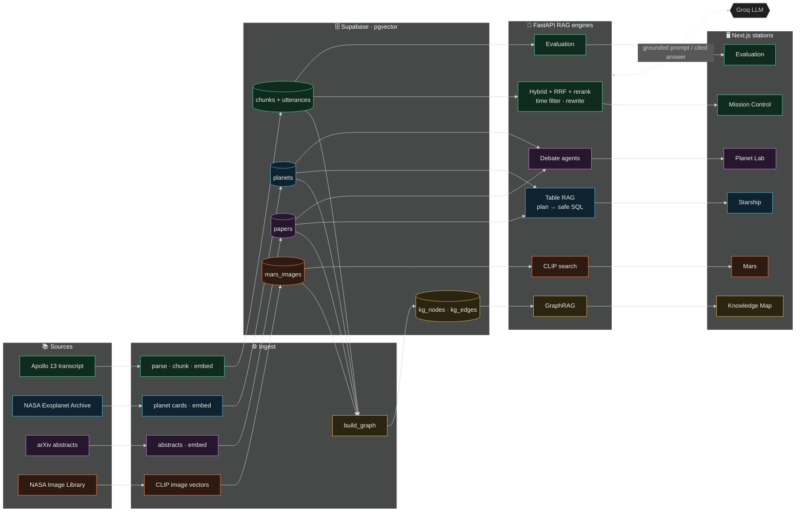
</details>

<details>
<summary><b>🧩 How each part works</b></summary>
<br/>

- **Chunking:** the transcript is split into whole conversations (≤600 characters, new chunk after 5 minutes of silence, one line of overlap), never mid-sentence.
- **Embeddings:** `BAAI/bge-small-en-v1.5` (384-d) for text, CLIP ViT-B/32 (512-d) for pictures, all run locally with fastembed (ONNX).
- **Hybrid search:** pgvector cosine + Postgres full-text, fused with Reciprocal Rank Fusion inside one SQL function.
- **Reranking:** `ms-marco-MiniLM-L-6-v2` cross-encoder; passages below a score of −2 are dropped, so irrelevant text never reaches the model.
- **Time filter:** every chunk is trimmed line by line to the current mission time.
- **Query rewriting:** vague questions ("Is that bad?") are rewritten using the last radio lines before searching.
- **Table RAG safety:** columns, operators and values are whitelisted; values only travel as SQL parameters (tested in `backend/tests/test_stations.py`).
- **GraphRAG:** nodes and edges keep their evidence (chunk ids, planet names, paper ids, picture ids), which is exactly what gets retrieved.
- **Streaming:** answers arrive token by token over server-sent events, with sources sent first.
</details>

---

## 📊 Evaluation


| Method | Hit@1 | Hit@3 | Hit@5 | MRR@10 |
|---|:-:|:-:|:-:|:-:|
| Semantic only | 8% | 28% | 36% | 0.19 |
| Keyword only | 8% | 16% | 20% | 0.14 |
| Hybrid (RRF) | 16% | 28% | 32% | 0.23 |
| **Hybrid + rerank (ODYSSEY)** | **32%** | **44%** | **44%** | **0.36** |

<sub>25 questions whose answer time in the transcript is known, plus 3 the transcript cannot answer. Strict scoring: a hit only counts if the retrieved chunk covers the exact moment of the answer. Run it yourself with <code>python scripts/run_eval.py</code>.</sub>

---

## 🧰 Tech stack

| Layer | Tools |
|---|---|
| Frontend | Next.js 15 · React 19 · TypeScript · three.js · d3-force · canvas animations |
| Backend | FastAPI · server-sent events · psycopg 3 |
| Database | Supabase Postgres · **pgvector** · full-text search · row-level security |
| Models | bge-small-en-v1.5 · MiniLM cross-encoder · CLIP ViT-B/32 (fastembed) · Groq `gpt-oss-120b` |
| Data | NASA Apollo 13 transcript (Spacelog) · NASA Exoplanet Archive · arXiv · NASA Image Library |

---

## 🛠️ Run it yourself

<details>
<summary><b>Step-by-step setup (Windows)</b></summary>
<br/>

**1. Database.** In Supabase → SQL Editor, run `backend/sql/001_schema.sql`, then `backend/sql/002_stations.sql`.

**2. Backend.**
```bash
cd backend
python -m venv .venv
.venv\Scripts\activate
pip install -r requirements.txt
```
Copy `.env.example` to `.env` and fill in `DATABASE_URL` (Supabase Session pooler) and `LLM_API_KEY` (Groq). **Never commit `.env`.**

**3. Load the data (once).**
```bash
python scripts/ingest_apollo13.py
python scripts/ingest_exoplanets.py
python scripts/ingest_papers.py
python scripts/ingest_mars.py
python scripts/build_graph.py
python scripts/run_eval.py
```

**4. Start.**
```bash
uvicorn app.main:app --reload --port 8000
```
```bash
cd frontend
npm install
npm run dev
```
Open http://localhost:3000.
</details>

<details>
<summary><b>API endpoints</b></summary>
<br/>

| Endpoint | What it does |
|---|---|
| `GET /health` | Database and AI status |
| `POST /ask` | Station 1: streamed, cited answers (`sources` → `token` → `done`) |
| `GET /decisions` · `POST /decisions/{id}/answer` | Crisis decisions graded from the transcript |
| `POST /starship/ask` | Table + paper RAG (`plan` → `sources` → `token`) |
| `POST /lab/similar` · `POST /lab/debate` | Analog planets and the streamed debate |
| `POST /mars/search` · `GET /mars/similar/{id}` · `POST /mars/upload` · `POST /mars/brief` | Multimodal search and briefings |
| `GET /graph` · `POST /graph/ask` | Knowledge graph and GraphRAG |
| `GET /eval` | Latest evaluation results |
</details>

<details>
<summary><b>Refresh the screenshots and the tour</b></summary>
<br/>

```bash
cd frontend
npx playwright install chromium
node scripts/screenshots.mjs http://localhost:3000
cd ..
python docs/readme/make_tour.py
```
</details>

---

## 🙏 Data and credits

- **Apollo 13 transcript:** NASA (public domain), cleaned by [Spacelog](https://github.com/Spacelog/Spacelog) (CC0).
- **Exoplanets:** [NASA Exoplanet Archive](https://exoplanetarchive.ipac.caltech.edu/), operated by Caltech under contract with NASA.
- **Papers:** abstracts from the [arXiv API](https://info.arxiv.org/help/api/). Thank you to arXiv for use of its open access interoperability.
- **Mars pictures:** [NASA Image and Video Library](https://images.nasa.gov/); pictures are linked, not copied.

<div align="center">
<br/>

</div>
