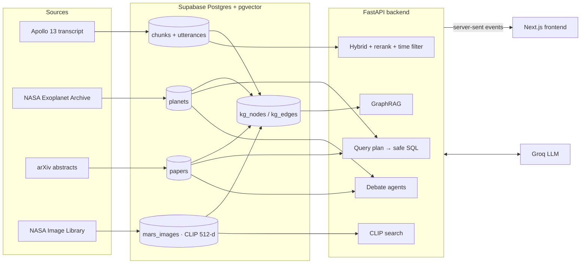

# ODYSSEY

**A space mission game powered by RAG.** You are a NASA flight director in training. You relive Apollo 13 and make its crisis decisions, explore Mars through NASA's photos, fly a 3D map of every known exoplanet, invent a planet and watch AI scientists argue about it, and finally see everything connected in one knowledge graph. Every answer comes from retrieved real data (transcripts, tables, papers, pictures) and cites its source.

| Station | What you do | Retrieval used |
|---|---|---|
| 1. Mission Control | Relive Apollo 13 in mission time, talk to the crew, make the 7 crisis calls | Hybrid search + RRF + rerank, time-filtered; query rewriting; decision grading |
| 2. Mars | Search NASA's Mars photos with words, a photo, or your own picture | **Multimodal RAG** (CLIP image vectors + caption keywords) |
| 3. Starship | Fly through ~6,000 real exoplanets in 3D and ask the science officer | **Table RAG** (validated query plans) + paper RAG |
| 4. Planet Lab | Build a planet; three AI scientists debate whether it could host life | Analog retrieval + paper RAG + **multi-agent debate** |
| 5. Knowledge Map | One graph linking all the stations; ask cross-source questions | **GraphRAG** |
| Evaluation | Retrieval measured on 28 questions with known answers | Hit@k, MRR, coverage, faithfulness |

## Build status

- [x] **Phase 1a: the RAG foundation.** 11,264 timestamped lines, 2,264 conversation chunks in Supabase (pgvector + full-text). Hybrid search, reranking, time filter, streaming grounded answers.
- [x] **Phase 1b: Mission Control.** Radio loop replayed in mission time, timeline, trajectory, systems lights, master alarm, talk to FLIGHT or the crew.
- [x] **Decision points and debrief.** The clock stops at 7 real decisions (power-down, REAC valve, lifeboat, free return, PC+2, the CO2 "mailbox", separation order). After you choose, RAG retrieves the radio lines around that moment and FLIGHT explains what Houston actually did. A debrief scores you against Houston.
- [x] **Evaluation dashboard.** Four retrieval methods compared on Hit@1/3/5 and MRR, plus "knows when it doesn't know" and LLM-judged faithfulness.
- [x] **Station 3, Starship.** NASA Exoplanet Archive table, Three.js 3D galaxy, table RAG + arXiv paper RAG.
- [x] **Station 4, Planet Lab.** Planet builder, real analogs, advocate / skeptic / chair debate with a habitability score.
- [x] **Station 2, Mars.** NASA Image Library pictures indexed with CLIP: text-to-image, image-to-image, upload-your-photo, cited briefings.
- [x] **Knowledge graph and Knowledge Map.** Graph built from evidence in every station, force-directed map, GraphRAG answers.

## Architecture



### Station 1: time-filtered hybrid retrieval

```
question ─┬─ embed (bge-small) ──► vector search ─┐
          └─ keywords ───────────► full-text ─────┴─ RRF fusion
             + time filter: only lines spoken before "now" (chunks trimmed line by line)
             → cross-encoder rerank → drop passages below -2 → cite [n] → stream
```

Vague questions ("What just happened?") are **rewritten** using the last radio lines before searching. **Crew mode** answers as Lovell, Haise, Swigert or CapCom, who only know what has been said so far. **Decisions** retrieve evidence only from a window around the real moment, so FLIGHT's explanation is grounded in what Houston said then.

### Station 3: table RAG

A table answers "the 5 closest rocky planets in the habitable zone" exactly, but only with a query. The model writes a **JSON plan** (filters, sort, limit, aggregate), never SQL. The backend checks every column and operator against a whitelist and builds **parameterised SQL** itself, so a malicious question cannot run anything (see `tests/test_stations.py`). The plan and the SQL are shown in the interface. Paper abstracts are searched in parallel (hybrid + rerank) for scientific context.

### Station 2: multimodal RAG

CLIP (ViT-B/32) maps pictures and words into **one** 512-number space. "Dust devil" finds dust devil photos whose captions never say so. Picture search is fused with caption keywords (RRF). "More like this" and photo upload search image-to-image. Briefings are written only from the retrieved captions and cite each picture.

### Station 4: retrieval for agents

Your planet becomes a feature vector (log radius, mass, period, starlight, star temperature) and is matched with the nearest **real** planets. A search phrase built from its properties ("M dwarf, tidal locking, habitable zone") retrieves papers. The advocate argues for life, the skeptic rebuts, and the chair weighs both and gives a score. All three may only cite the retrieved evidence.

### Station 5: GraphRAG

`build_graph.py` creates nodes (spacecraft, systems, people, decisions, planets, stars, telescopes, topics, papers, rovers, Mars places) and edges **from evidence**: co-mention in radio conversations, planet → star → topic, co-occurrence in picture captions, plus cross-station bridges. Each node and edge stores its evidence. A question is answered by **entity linking** (vectors + names/aliases), **one-hop expansion**, collecting the evidence on those nodes and edges, reranking it, and answering from graph facts + numbered evidence.

### Evaluation

`data/eval_set.json` holds 25 questions whose answer time in the transcript is known, plus 3 that the transcript cannot answer. `run_eval.py` compares **semantic only, keyword only, hybrid, hybrid + rerank** (Hit@1, Hit@3, Hit@5, MRR@10), checks the coverage signal on unanswerable questions, and with `--answers` asks a judge model what fraction of each answer's claims the sources support.

## Data

- **Apollo 13 transcript:** NASA (public domain), cleaned by [Spacelog](https://github.com/Spacelog/Spacelog) (CC0).
- **Exoplanets:** [NASA Exoplanet Archive](https://exoplanetarchive.ipac.caltech.edu/), Planetary Systems Composite table. This research has made use of the NASA Exoplanet Archive, which is operated by the California Institute of Technology under contract with NASA.
- **Papers:** abstracts from the [arXiv API](https://info.arxiv.org/help/api/). Thank you to arXiv for use of its open access interoperability.
- **Mars pictures:** [NASA Image and Video Library](https://images.nasa.gov/). NASA images are generally not copyrighted; pictures are linked, not copied.

## Project layout

```
frontend/
  app/page.tsx                hub
  app/mission-control/        Station 1 (+ decisions and debrief)
  app/mars/  app/starship/  app/planet-lab/  app/knowledge-map/  app/eval/
  components/                 Radio, Timeline, Trajectory, Comms, Decision, Galaxy3D, Answer, Shell
  lib/                        API client (streaming), mission time, systems lights
backend/
  app/
    main.py        core endpoints + decisions + eval
    rag.py         hybrid retrieval, reranking, prompts (Station 1)
    decisions.py   crisis decisions graded from the transcript
    evaluate.py    retrieval evaluation
    starship.py    table RAG + paper search
    planets.py     planet facts (size class, habitable zone, ESI)
    lab.py         analogs + debate agents
    mars.py        CLIP picture search + briefings
    graph.py       GraphRAG
    embeddings.py  text embeddings, reranker, CLIP
  data/            decisions.json, eval_set.json
  scripts/         ingest_apollo13.py, ingest_exoplanets.py, ingest_papers.py, ingest_mars.py, build_graph.py, run_eval.py
  sql/             001_schema.sql, 002_stations.sql
  tests/           pytest
```

## Setup (Windows)

### 1. Create the database tables
Supabase → your project → **SQL Editor** → **New query** → paste all of `backend/sql/001_schema.sql` → **Run**. Then a new query with all of `backend/sql/002_stations.sql` → **Run**.

### 2. Install the backend
```bash
cd backend
python -m venv .venv
.venv\Scripts\activate
pip install -r requirements.txt
```
If `activate` is blocked, run `Set-ExecutionPolicy -Scope CurrentUser RemoteSigned` once.

### 3. Add your keys
Copy `backend/.env.example` to `backend/.env`; fill in `DATABASE_URL` (Supabase → **Connect** → **Session pooler**) and `LLM_API_KEY` (Groq).

### 4. Load the data (once, in this order)
```bash
python scripts/ingest_apollo13.py     # about 5 min
python scripts/ingest_exoplanets.py   # about 2 min
python scripts/ingest_papers.py       # about 2 min
python scripts/ingest_mars.py         # 5 to 10 min (downloads CLIP)
python scripts/build_graph.py         # under 1 min
python scripts/run_eval.py            # about 1 min (add --answers for judged answers)
```

### 5. Run
```bash
uvicorn app.main:app --reload --port 8000
```
In a second terminal:
```bash
cd frontend
npm install
npm run dev
```
Open **http://localhost:3000**.

## API

| Endpoint | What it does |
|---|---|
| `GET /health` | Database and AI status |
| `GET /missions/a13`, `GET /missions/a13/utterances` | Mission structure and the radio replay |
| `POST /search`, `POST /ask` | Station 1 retrieval and streamed answers (`sources`, `token`, `done`) |
| `GET /decisions`, `POST /decisions/{id}/answer` | Crisis decisions; `{choice}` → verdict, explanation, evidence |
| `GET /eval` | Last evaluation results |
| `GET /planets/galaxy`, `GET /planets/{name}` | 3D map data, one planet with siblings and papers |
| `POST /starship/ask` | Table + paper RAG (`plan`, `sources`, `token`, `done`) |
| `POST /lab/similar`, `POST /lab/debate` | Planet card and analogs; streamed debate (`turn`, `token`, `score`) |
| `GET /mars/gallery`, `POST /mars/search`, `GET /mars/similar/{id}`, `POST /mars/upload`, `POST /mars/brief` | Picture search and briefings |
| `GET /graph`, `GET /graph/node/{id}`, `POST /graph/ask` | Knowledge graph and GraphRAG |

## Tests

```bash
pytest -q
```
